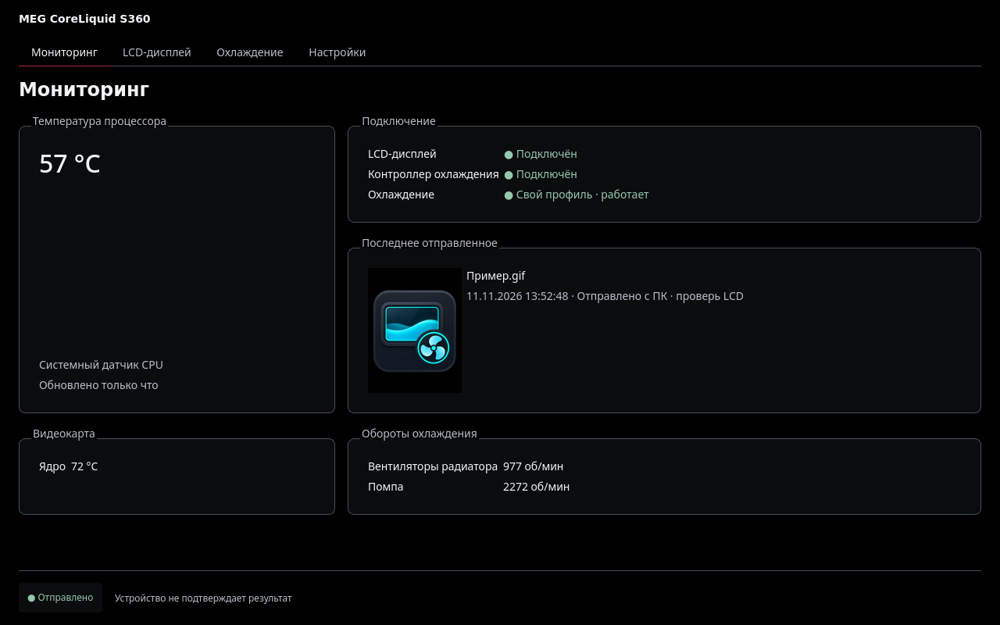
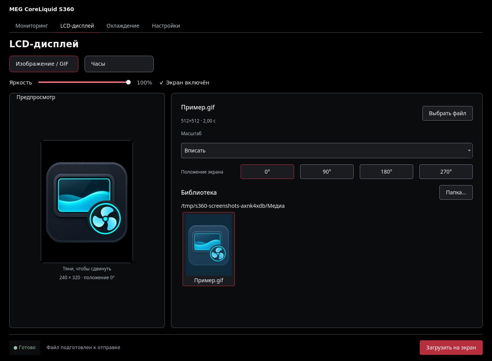
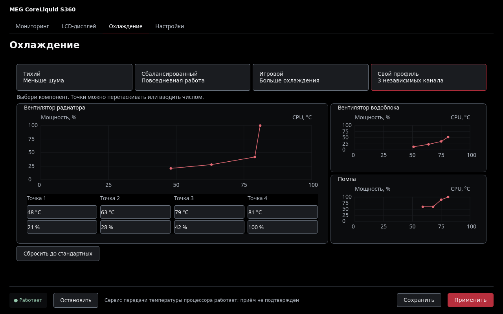

# S360 Control


Linux-приложение для **MSI MEG CoreLiquid S360**: управление LCD, охлаждением и мониторинг.
Разработано для **CachyOS / Arch Linux, Hyprland / Wayland**. Интерфейс на русском, три темы оформления.

## Возможности

- GIF/MP4 на LCD: библиотека, плавное кадрирование мышью, масштаб и положение экрана.
- Яркость, включение экрана и пять стилей часов MSI.
- Готовые режимы охлаждения и свои кривые вентиляторов и помпы.
- Температуры CPU/GPU, обороты радиатора и помпы, история последнего отправленного изображения.

## Скриншоты

Снимки работающего интерфейса с демонстрационными данными, без обращения к устройству.

**Мониторинг**



**LCD-дисплей**



**Охлаждение**



## Установка и обновление

Зависимости: Python 3.12+, PySide6, pyusb, ffmpeg/ffprobe.

```sh
git clone https://github.com/Wenwu-PA/s360-control.git
cd s360-control
./install.sh
```

Запуск: **S360 Control** в меню приложений или `s360-control` в терминале.
Установщик предлагает поставить недостающие пакеты и правило доступа USB;
сервис охлаждения автоматически не запускается.

Для обновления закрой приложение, выполни `git pull` и повтори `./install.sh`.
Настройки и журнал LCD сохраняются. Удаление: `./uninstall.sh`.
Без sudo: `./install.sh --no-system` (зависимости и права USB должны быть настроены).

Архивы стабильных версий — в [Releases](https://github.com/Wenwu-PA/s360-control/releases).

## Полезно знать

После отправки проверь изображение на LCD: устройство не подтверждает приём.
Температура жидкости и режим Hardware Monitor на самом LCD пока недоступны.

[Подробная инструкция и CLI](docs/USAGE.md) ·
[Подтверждённый протокол](docs/PROTOCOL_VERIFIED.md) ·
[Открытые вопросы](docs/OPEN_QUESTIONS.md)
